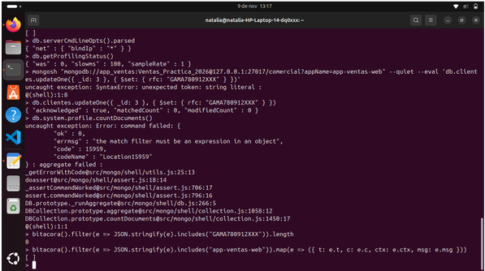
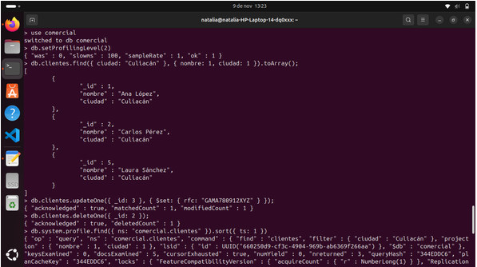
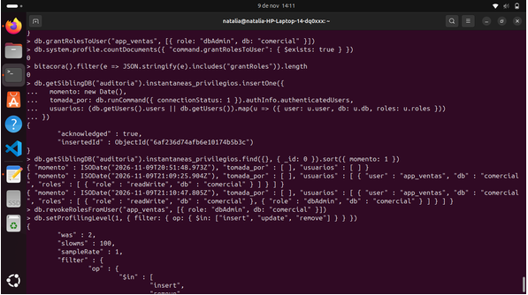

# Actividad 10 — Responder a Dirección

1. ¿Quién cambió el RFC de María García en la Actividad 2? ¿Y en la Actividad 3?

    En la Actividad 2: No hay evidencia con esta edición. Como el perfilador estaba apagado ("was": 0), MongoDB no guardó quién hizo el cambio ni dejó rastro de la modificación en la bitácora.

    En la Actividad 3: Al encender el perfilador ("was": 2), sí quedó registrado el cambio del RFC. Cuando la aplicación se conecta con su cuenta, el perfilador muestra el usuario en el campo user (app_ventas@comercial); en la prueba hecha directo desde la consola interna sin iniciar sesión por red, ese campo sale vacío.

2. ¿Cuándo y desde qué aplicación?

    En la Actividad 2: No hay evidencia con esta edición. Al estar apagado el perfilador, no se guardó ni la hora ni el nombre del programa que modificó el dato.

    En la Actividad 3: Con el perfilador encendido, la hora exacta quedó guardada en el campo ts (el 9 de noviembre de 2026) y el programa quedó en el campo appName (que registra app-ventas-web cuando entra la aplicación web, o MongoDB Shell cuando se hace desde la terminal).

3. ¿Qué valor tenía antes?

    En la Actividad 2 y en la Actividad 3: No hay evidencia con esta edición. MongoDB Community no guarda una copia de cómo estaba el dato antes de cambiarlo. El perfilador solo anota el valor nuevo que se puso (GAMA780912XYZ), así que no se puede recuperar el RFC anterior (GAMA780912GHI) desde los registros.

4. ¿Cambió alguien los privilegios de app_ventas?

    En la bitácora o el perfilador: No hay evidencia con esta edición. La versión Community no registra cuando se dan o quitan permisos (grantRolesToUser), por eso la búsqueda sale en 0.

    Con las instantáneas (control compensatorio): Al comparar las dos capturas guardadas en auditoria.instantaneas_privilegios (de las 21:09:25 y 21:10:47), sí se comprueba que los permisos cambiaron, porque a app_ventas le agregaron el rol dbAdmin. Sin embargo, no hay evidencia de quién le dio ese permiso ni de la hora exacta en que ocurrió.

