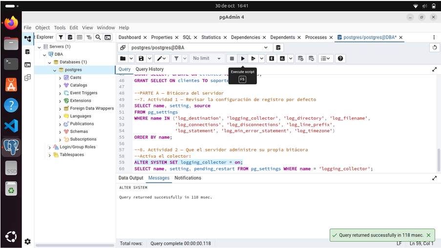

# Montoya Martinez Natalia Fecha:06 de Noviembre del 2026
# 8. Actividad 2 — Que el servidor administre su propia bitácora

Preguntas

1.-¿Por qué logging_collector requiere reinicio y log_statement solo recarga?
logging_collector (Reinicio): Modifica la arquitectura de procesos del motor. Activar o desactivar el colector requiere que PostgreSQL levante o destruya en memoria un proceso en segundo plano dedicado (logger process) que captura la salida de error (stderr) del servidor desde su arranque inicial.
log_statement (Recarga): Es un parámetro de comportamiento dinámico. Solo define qué sentencias SQL vigentes evalúa e imprime el motor durante la ejecución de consultas, por lo que los procesos existentes pueden aplicar el cambio en caliente sin reiniciar el servicio (SELECT pg_reload_conf()).

2.-¿Qué ventaja tiene que la bitácora se lea con SQL y no con una herramienta del sistema operativo o del contenedor? ¿Qué riesgo introduce?
Ventaja: Abstracción e independencia del entorno de despliegue. Permite filtrar, ordenar y analizar eventos usando toda la potencia de consultas SQL (WHERE, ILIKE, ORDER BY, expresiones regulares) directamente desde cualquier cliente (psql, pgAdmin) sin depender de credenciales del sistema operativo, acceso SSH o comandos del contenedor (docker logs).
Riesgo: Exposición de seguridad y consumo de recursos. La función subyacente (pg_read_file) permite leer archivos del servidor; si la vista dba.bitacora se expone sin el debido control de accesos, usuarios no autorizados podrían visualizar información sensible registrada en el log. Además, realizar búsquedas SQL complejas en archivos de log de gran tamaño genera carga de trabajo innecesaria (CPU y E/S) sobre el propio motor de la base de datos.

3.-¿Quién debería poder consultar dba.bitacora?
Únicamente la cuenta de administrador de la base de datos (DBA / superusuario) o un rol de auditoría de seguridad especializado, bajo el principio de mínimo privilegio.
Los roles operativos (app_ventas), cuentas de soporte (soporte_ana) o usuarios de la aplicación jamás deben tener permisos de lectura sobre este esquema o vista, ya que la bitácora contiene evidencias del sistema, rastros de errores y metadatos de seguridad.

Interpretación:
Muestra la modificación del parámetro global logging_collector a on. Esta sentencia escribe la configuración en postgresql.auto.conf para habilitar el proceso de fondo (logger process) que captura las salidas de error (stderr) de la instancia. Requiere reiniciar el servicio de PostgreSQL para activarse.