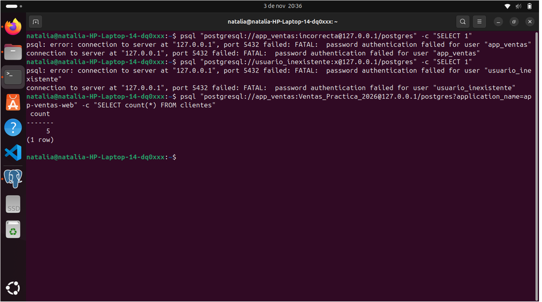

# Montoya Martinez Natalia Fecha:06 de Noviembre del 2026
# 11. Actividad 5 — Accesos exitosos y fallidos

Preguntas

1. La bitácora registra el usuario app_ventas en el intento fallido. ¿Eso prueba que la aplicación de ventas intentó entrar? ¿Qué prueba realmente? No prueba que haya sido la aplicación web real. Solo demuestra que desde esa IP se intentó ingresar usando el nombre app_ventas, pero falló la contraseña.

2. ¿Qué información adicional registra PostgreSQL cuando el rol no existe? ¿Por qué aparece en la bitácora y no en el mensaje que recibe el cliente? Registra la causa técnica exacta (role "usuario_inexistente" does not exist). Solo se guarda en la bitácora para evitar que atacantes descubran qué usuarios existen (enumeración de cuentas), enviando al cliente un mensaje genérico.

3. ¿Por qué app=[unknown] en el intento fallido, pero app=app-ventas-web en la desconexión? En el intento fallido, la conexión se canceló antes de autenticarse, por lo que nunca procesó el nombre de la app. En la desconexión sí aparece porque la sesión se estableció de forma exitosa previo a cerrar.

4. ¿Qué patrón de varias líneas te haría sospechar de un ataque de fuerza bruta? Escribe la consulta que contaría los intentos fallidos por usuario. Ver múltiples líneas consecutivas de password authentication failed desde la misma IP en cuestión de segundos.

