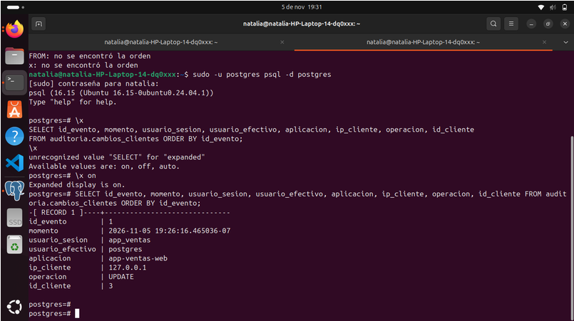

# Montoya Martinez Natalia Fecha:06 de Noviembre del 2026

# 18. Actividad 12 — El incidente auditado

Preguntas

1. Compara tu hipótesis de la Actividad 11 con este resultado. La hipótesis se confirma correctamente: gracias a que la función se configuró con SECURITY DEFINER, la actualización ejecutada por app_ventas se completó con éxito y el disparador pudo escribir sin problemas en la tabla de auditoría, capturando tanto el dato previo (antes) como el nuevo (despues) a pesar de que la aplicación no tiene permisos directos para leer o escribir en ese esquema.

2. Escribe la sentencia UPDATE que restauraría el valor anterior. Tomando el valor previo registrado en la columna antes y aplicándolo al cliente correspondiente, la sentencia para dejar la información como estaba originalmente es:
UPDATE clientes SET rfc = 'GAMA780912X99' WHERE id = 3;

3. ¿Qué columna conserva más valor para una investigación: aplicacion o ip_cliente? ¿Cuál puede falsificar el cliente con más facilidad? La columna ip_cliente conserva más valor investigativo porque registra el origen real del tráfico a nivel de red, mientras que la columna aplicacion (application_name) es la que el cliente puede falsificar más fácilmente, ya que es simplemente un texto de configuración que cualquier usuario puede cambiar libremente en las propiedades de su programa de conexión.

# 19. Actividad 13 — Altas y bajas

Preguntas

1. El cliente Pedro Ruiz ya no existe en clientes. ¿Dónde queda evidencia de que existió y de sus datos? La evidencia queda guardada de forma permanente en la tabla de auditoría (auditoria.cambios_clientes), donde el disparador (trigger) registró automáticamente tanto la creación (evento INSERT) como la eliminación (evento DELETE), conservando la información completa del cliente y su RFC dentro del registro histórico en los campos JSON.

2. ¿Por qué ip_cliente está vacía en los eventos 2 y 3? Aparece vacía (o como dirección de bucle local) porque el administrador realizó las operaciones mediante una conexión local directa en el mismo equipo (a través de sockets de Unix o localhost), por lo que la función de red de PostgreSQL no recibe una dirección IP remota de un cliente externo.

3. La política de retención de la Unidad II pedía eliminar datos cuando ya no fueran necesarios. ¿Qué conflicto aparece? ¿Quién debe resolverlo? Existe un conflicto entre el derecho al olvido y privacidad (que exige borrar datos personales) y la obligación de auditoría inalterable (que exige conservar registros para investigaciones de seguridad); este dilema debe ser resuelto formalmente entre el área legal, el oficial de seguridad/privacidad (CISO) y el DBA definiendo plazos de retención y reglas de anonimización de bitácoras.

# 20. Actividad 14 — Intentar manipular la auditoría

Preguntas

1. ¿Qué evidencia permite detectar que hubo un cambio sin auditar? Se detecta por la discrepancia entre los datos reales de la tabla y la bitácora de auditoría; por ejemplo, cuando el valor de un campo cambia pero no existe el evento correspondiente registrado en auditoria.cambios_clientes, o cuando la instrucción aparece en los registros generales del servidor pero no generó ninguna entrada en la tabla del disparador debido a que este fue desactivado o evadido.

2. ¿Qué control administrativo (no técnico) reduciría este riesgo? El control administrativo principal es implementar una política de gestión de cambios junto con el principio de doble autorización (o regla de cuatro ojos), lo que exige que cualquier mantenimiento, modificación directa en producción o desactivación temporal de disparadores deba solicitarse, justificarse y aprobarse formalmente por un supervisor o comité antes de su ejecución.

3. Relaciona esta actividad con el principio de separación de funciones de la Unidad II. Se relaciona directamente porque exige que el administrador de la base de datos (DBA), el usuario de la aplicación y el auditor de seguridad sean roles completamente independientes; al separar estas funciones, se evita que una sola persona con altos privilegios pueda modificar información del negocio y, al mismo tiempo, apagar los disparadores o alterar las tablas de auditoría para encubrir sus acciones.

