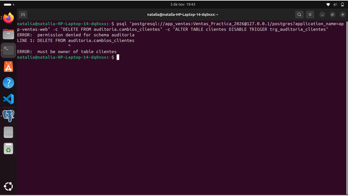

# Montoya Martinez Natalia Fecha:06 de Noviembre del 2026
# 21. Actividad 15 — Límites: lecturas y volumen

Preguntas

1. Si clientes tuviera un millón de registros, ¿qué ocurriría con la auditoría tras un UPDATE sin WHERE? Al ser un disparador a nivel de fila (FOR EACH ROW), el disparador se ejecutaría un millón de veces dentro de la misma transacción. Esto generaría un millón de inserciones adicionales de objetos JSONB en la tabla auditoria.cambios_clientes, lo que provocaría un consumo masivo de almacenamiento y espacio en los registros WAL, un aumento extremo en la latencia e I/O de disco, bloqueos prolongados sobre la tabla y el riesgo de colapsar el servidor o cancelar la transacción por límite de tiempo (timeout).

2. Propón quién podría autorizar la depuración de auditoria.cambios_clientes. Para mantener la separación de funciones y evitar que un usuario elimine evidencias de sus propias acciones, la depuración nunca debe depender del DBA de forma unilateral. Debe ser autorizada mediante un comité de gobernanza integrado por el Oficial de Seguridad de la Información (CISO), el Área Legal / Cumplimiento y el Oficial de Protección de Datos (DPO), basándose estrictamente en los plazos de conservación exigidos por las normativas vigentes.

3. ¿Por qué log_statement = 'all' puede convertir la bitácora en un nuevo depósito de datos sensibles? Porque registra en texto plano la totalidad de los comandos ejecutados por los usuarios, incluyendo las lecturas (SELECT) y modificaciones con valores literales. Si las consultas contienen contraseñas, números de tarjeta, RFCs o datos personales (PII), estos quedan escritos directamente en los archivos de registro del sistema operativo. Si la bitácora no tiene restricciones de acceso rigurosas, se transforma en un vector de fuga de información expuesto a administradores de sistemas o herramientas de monitoreo.

