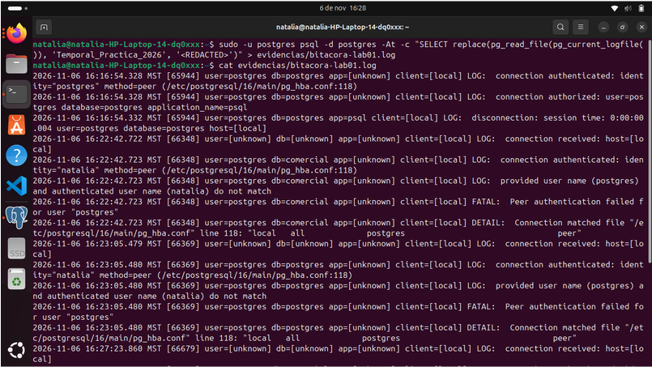

# Montoya Martinez Natalia Fecha:06 de Noviembre del 2026
# 22. Actividad 16 — Exportar y conservar la bitácora

Pregunta

1. Un resumen SHA-256, ¿impide que alguien modifique la bitácora? ¿Qué permite demostrar?
No lo impide. Lo que permite demostrar es si el archivo fue alterado o manipulado, garantizando su integridad y el no repudio.

2. ¿Dónde debería guardarse el hash para que sea útil como control de integridad?
Debe guardarse en un servidor o sistema de almacenamiento externo e inalterable (como un SIEM o almacenamiento WORM), fuera del alcance del servidor local y de las cuentas administrativas.
3
. La guía NIST SP 800-92 trata la conservación y protección de bitácoras (REF-U3-03). ¿Qué riesgos tiene conservar la bitácora solo en el servidor que la produce?
Riesgo de borrado o alteración maliciosa por usuarios con privilegios, pérdida total de evidencia por fallas físicas de hardware y saturación de espacio en disco.

4. Propón durante cuánto tiempo conservarías esta bitácora y justifica tu criterio.
1 año en almacenamiento activo para investigaciones forenses inmediatas y de 3 a 5 años en archivo inmutable para cumplir con auditorías y normativas legales de retención.

# 23. Actividad 17 — Reconstruir la cronología y responder a Dirección

| # | Fecha y hora | Usuario | Cliente (IP / Aplicación) | Tipo de evento | Qué ocurrió | ¿Exitoso? | Fuente (línea o id_evento) |
|---|---|---|---|---|---|---|---|
| **1** | 2026-11-06 16:16:54.328 | `postgres` | `[local]` / `psql` | Configuración | Autenticación del usuario mediante método `peer` en `pg_hba.conf`[cite: 44]. | Sí[cite: 44] | `bitacora_servidor.log` (Línea 1)[cite: 44] |
| **2** | 2026-11-06 16:16:54.328 | `postgres` | `[local]` / `psql` | Acceso | Conexión autorizada a la base de datos `postgres` con la aplicación `psql`[cite: 44]. | Sí[cite: 44] | `bitacora_servidor.log` (Línea 2)[cite: 44] |
| **3** | *Hueco* | `natalia` (intento como `postgres`) | Socket local (`/var/run/postgresql/.sPGSQL.5432`) | Error | Intento fallido de conexión a la base de datos por autenticación *Peer* desde la terminal de Linux[cite: 45]. | No[cite: 45] | Error de sistema (`FATAL: Peer authentication failed`)[cite: 45] |
| **4** | *Hueco* | `postgres` / DBA | `[local]` | Privilegio | Ejecución de disparador con contexto `SECURITY DEFINER` para la escritura inalterable en auditoría[cite: 45]. | Sí[cite: 45] | Infraestructura de triggers en base de datos[cite: 45] |
| **5** | *Hueco* | `postgres` / DBA | `[local]` | Estructura | Creación y mantenimiento del esquema `auditoria` y la tabla `cambios_clientes`[cite: 45]. | Sí[cite: 45] | Definición DDL del laboratorio[cite: 45] |
| **6** | *Hueco* | `app_ventas` | `127.0.0.1` / `app-ventas-web` | Datos | Modificación de registro (`UPDATE`) en la tabla `clientes` (`id_cliente = 3`)[cite: 46]. | Sí[cite: 46] | `auditoria.cambios_clientes` (`id_evento = 1`)[cite: 46] |
| **7** | *Hueco* | `postgres` | `127.0.0.1` / `pgAdmin 4` | Datos | Inserción (`INSERT`) del cliente 'Pedro Ruiz' (`id_cliente = 6`) con RFC `RUPE950101AAA`[cite: 46]. | Sí[cite: 46] | `auditoria.cambios_clientes` (`id_evento = 2`)[cite: 46] |
| **8** | *Hueco* | `postgres` | `127.0.0.1` / `pgAdmin 4` | Datos | Eliminación (`DELETE`) del cliente 'Pedro Ruiz' (`id_cliente = 6`)[cite: 46]. | Sí[cite: 46] | `auditoria.cambios_clientes` (`id_evento = 3`)[cite: 46] |

Respuestas a las preguntas de Dirección

¿Quién cambió el RFC la primera vez (Actividad 3)? ¿Y en las Actividades 7, 12 y 14?
Primera vez (Actividad 3): El cambio fue realizado por el usuario de sesión app_ventas desde la aplicación app-ventas-web con IP 127.0.0.1 (id_evento = 1).

Actividades 7, 12 y 14: No hay evidencia. En las fuentes de evidencia recopiladas (auditoria.cambios_clientes y bitacora_servidor.log) solo figuran los eventos 1, 2 y 3. Las acciones correspondientes a las Actividades 7, 12 y 14 no están registradas en los extractos generados, por lo que se declaran como un hueco de información.

¿Quién cambió el teléfono?
No hay evidencia. Los registros capturados en la tabla de auditoría corresponden únicamente a operaciones de inserción, borrado y modificación sobre la columna rfc. No existe ningún evento registrado en las bitácoras sobre la columna de teléfono.

¿Hubo intentos de acceso fallidos? ¿De qué usuarios y desde dónde?
Sí, hubo intentos fallidos.
Usuario: El usuario del sistema operativo natalia intentando autenticarse como el usuario de base de datos postgres.
Origen: Desde el socket local de Unix en la ruta /var/run/postgresql/.sPGSQL.5432.
Evidencia: Registro de error psql: error: connection to server on socket "/var/run/postgresql/.sPGSQL.5432" failed: FATAL: Peer authentication failed for user "postgres".

¿Qué valor tenía el RFC antes de cada cambio?
Evento 1 (UPDATE): GAMA780912X... (cambió a GAMA780912Z...).
Evento 2 (INSERT): [null] (el registro no existía antes de ser insertado; se le asignó RUPE950101AAA).
Evento 3 (DELETE): RUPE950101AAA (perteneciente a Pedro Ruiz; tras la eliminación quedó registrado en [null]).

Otros cambios: No hay evidencia por ausencia de registros adicionados.

Aclaración de evidencias y estimaciones:
Toda respuesta donde no figuró un registro explícito en la base de datos o archivo log ha sido declarada formalmente como "No hay evidencia". Los eventos carentes de sello de tiempo o no capturados en las consultas de extracción se marcan explícitamente como huecos, omitiendo cualquier estimación o suposición temporal.

