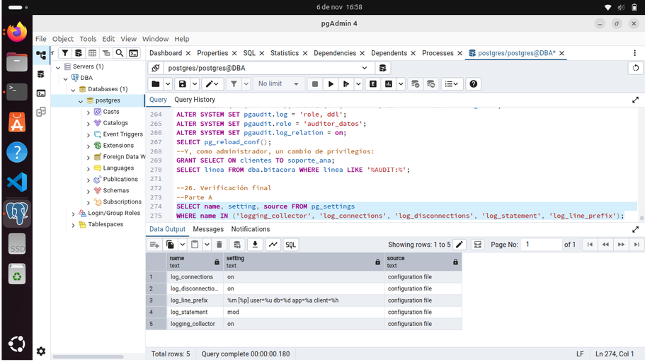

# Montoya Martinez Natalia Fecha:06 de Noviembre del 2026

# 24. Actividad 18 — Instalar y cargar pgaudit

# 25. Actividad 19 — Auditoría de objeto sobre columnas sensibles

Preguntas

¿Por qué no apareció SELECT nombre, ciudad ...? ¿Por qué sí apareció SELECT * ...?
SELECT nombre, ciudad ... no pide datos protegidos, así que la auditoría la ignora. En cambio, SELECT * ... pide absolutamente todas las columnas, incluyendo el RFC y el teléfono que sí están vigilados, por lo que la registra de inmediato.

¿Por qué no apareció UPDATE ... ciudad ...?
Porque la auditoría solo está vigilando los cambios en el RFC y el teléfono. Como en esa consulta solo se modificó la ciudad, el sistema no la toma en cuenta.

¿Qué diferencia de volumen esperarías frente a log_statement = 'all'?
Se llena muchísimo menos el disco. log_statement = 'all' guarda absolutamente todo lo que pasa en el sistema (generando archivos gigantes de basura), mientras que pgaudit solo guarda los accesos a los datos confidenciales.

El README oficial advierte que pgaudit no puede auditar de forma confiable a los superusuarios (REF-U3-09). 

¿Qué implica para la separación de funciones?
Significa que la cuenta de administrador (postgres) no debe usarse para el trabajo diario. Como el administrador tiene todo el control, podría apagar la auditoría para ocultar lo que hace. Por eso, las aplicaciones y usuarios deben usar cuentas limitadas que sí queden registradas.

# 26. Verificación final

